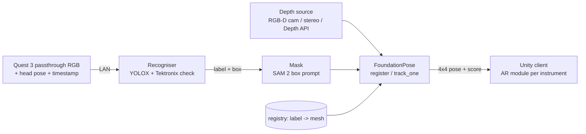

# FoundationPose integration study (pose stage for Leonardo AR)

Goal of the next stage: once the recogniser says *which* oscilloscope it sees (RTB2004 / TDS 2014 / TDS 1002), estimate
its full 6D pose (position + orientation) so the AR content can be anchored on the real instrument, and keep tracking it.
This document studies [NVlabs/FoundationPose](https://github.com/NVlabs/FoundationPose) for that job: what it needs,
what it returns, and how it would plug into the existing system (`server/app.py`, `unity/`).

Sources: the official repository README, `run_demo.py`, `datareader.py` and `LICENSE`; the paper
*FoundationPose: Unified 6D Pose Estimation and Tracking of Novel Objects* (Wen, Yang, Kautz, Birchfield,
[arXiv 2312.08344](https://arxiv.org/abs/2312.08344), CVPR 2024 Highlight per the README); Meta developer docs for the
[Passthrough Camera API](https://developers.meta.com/horizon/documentation/unity/unity-pca-overview/) and
[Depth API](https://developers.meta.com/horizon/documentation/unity/unity-depthapi-overview/). Status: October 2026.

---

## 1. What FoundationPose is

One network family for **6D pose estimation** (first frame) and **6D pose tracking** (following frames) of objects it
has never seen in training - no per-object training or fine-tuning.

- **Model-based mode:** the object is given as a 3D mesh (CAD model). This is the mode that fits us.
- **Model-free mode:** instead of a mesh, ~16 reference RGB-D views of the object; a neural object field (neural SDF) is
  fitted in seconds and used to render the object. Same pose modules afterwards.

How it works (paper):
1. **Hypotheses:** translation from the median depth inside the 2D detection; rotations from 42 viewpoints x 12
   in-plane rotations = **504 pose hypotheses**.
2. **Refinement (render-and-compare):** for each hypothesis the object is rendered and a transformer refiner predicts a
   pose update - 5 iterations for estimation (`est_refine_iter=5`), 1-2 for tracking (`track_refine_iter=2` in the demo).
3. **Selection:** a hierarchical scorer ranks all refined hypotheses and keeps the best.
4. **Tracking:** each new frame is compared with a rendering at the previous pose; only the refiner runs.

Reported numbers (paper): estimation ~**1.3 s per object**, tracking ~**32 Hz**, on an RTX 3090 + i9 CPU.
BOP model-based mean AR 83.3 (LM-O 78.8, T-LESS 83.0, YCB-V 88.0). The README notes the released weights are slightly
weaker than the paper's (the texture-augmented training data could not be released).

## 2. Inputs it needs (model-based, RGB-D workflow)

From `run_demo.py` and `datareader.py`:

| Input | Format | When | Notes |
|---|---|---|---|
| RGB image | H x W x 3, uint8 | every frame | |
| **Depth** | H x W float, **metres**, **aligned pixel-to-pixel with the RGB image** | every frame | the demo reads 16-bit PNG in mm and divides by 1000; values < 1 mm are treated as invalid |
| **Camera intrinsics K** | 3x3 (fx, fy, cx, cy) | every frame | must match the (possibly resized) RGB/depth |
| **Object mask** | H x W bool, the object's pixels | **first frame only** (`register`) | the detector box alone is not enough |
| **Mesh** | `.obj`/`.ply` loaded with trimesh, **metric scale (metres)** | once per object | textured is better (render-and-compare uses appearance) |

Demo folder layout (`YcbineoatReader`): `rgb/*.png`, `depth/*.png` (same names), `masks/*.png`, `cam_K.txt`.

Core API (verbatim from `run_demo.py`):
```python
est = FoundationPose(model_pts=mesh.vertices, model_normals=mesh.vertex_normals, mesh=mesh,
                     scorer=scorer, refiner=refiner, debug_dir=debug_dir, debug=debug, glctx=glctx)
pose = est.register(K=K, rgb=color, depth=depth, ob_mask=mask, iteration=est_refine_iter)   # first frame
pose = est.track_one(rgb=color, depth=depth, K=K, iteration=track_refine_iter)             # next frames
```

**Conclusion (agrees with the requirements document):** in the standard workflow FoundationPose needs an object mask
and metric depth aligned to the RGB image. Our recogniser's bounding box is only the *prompt* for the mask.

## 3. The 3D model per instrument

| Option | Effort | Quality | Notes |
|---|---|---|---|
| **Manufacturer CAD** (STEP/STL) | low, if available | best geometry | ask R&S and Tektronix / Leonardo; convert to `.obj` in metres, add textures |
| **Textured box mesh** from measurements + front/side photos | ~1 h per model | good enough for a first proof | the instruments are close to boxes; our generator already has front textures and real widths (`width_mm` in `config/instruments.yaml`) |
| **Photogrammetry** from a walk-around (we have videos v01/v02) | medium | good, real textures | needs scale fixing (one measured dimension) and clean-up |
| **Model-free mode** (16 RGB-D reference views) | medium | good | needs an RGB-D camera for the references; no mesh editing |

Important detail: the **TDS 2014 and TDS 1002 share the same case**. Their geometry is practically identical, so the pose
is right even if the two are confused; only the textures (front panel) and the AR content differ. The RTB2004 needs
its own mesh.

Proposal: add one field per instrument to the registry, so recognition -> mesh is a lookup:
```yaml
  - label: tek_tds2014
    mesh: models/meshes/tek_tds2014.obj    # metres, textured, origin at the box centre
```

## 4. From our detection to the mask

The recogniser returns `label`, `confidence`, normalised `bbox` per instrument. FoundationPose needs the pixel mask on
the first frame. Options, all prompted with our box:

| Option | Speed | Notes |
|---|---|---|
| **SAM 2** (box prompt) | real time on a GPU | also tracks the mask over video; best quality |
| EfficientSAM / MobileSAM | faster, lighter | single-frame box -> mask, good for constrained GPUs |
| Box-shaped mask from depth (pixels in the box within the object's depth range) | no extra model | crude, may work for box-like instruments on a table |

Only the registration frame needs a mask; tracking continues without one. When tracking is lost (low score, object
leaves the view) -> run the recogniser + mask + `register` again.

Use of the recognition result: run the pose stage only when the recogniser is confident; for "(model unclear)" the
Tektronix mesh is still usable for the pose (same case), but the AR content should wait for a confirmed model.

## 5. Depth on the Meta Quest 3 - the main risk

| Source | What it gives | Usable for FoundationPose? |
|---|---|---|
| **Passthrough Camera API** (Horizon OS v74+, Quest 3/3S) | left and right RGB cameras, 1280x960 (1280x1280 from v83), 60 Hz, 20-40 ms latency, helper classes for intrinsics/extrinsics, permission `horizonos.permission.HEADSET_CAMERA` | RGB yes; **no depth** |
| **Depth API** (Quest 3/3S) | environment depth for occlusion; unreliable closer than ~0.2 m; meant for rendering, not documented as raw metric depth aligned to the camera images | **not directly** - low resolution, smoothed, different viewpoint than the RGB camera; would need reprojection and testing |

Options for the proof of concept:
1. **External RGB-D camera** (e.g. Intel RealSense D435/D455 or Orbbec) on the lab PC - the standard FoundationPose
   setup, fastest way to prove the pose stage with our meshes. Recommended first step.
2. **Stereo depth from the two Quest passthrough cameras** (both are accessible, with intrinsics/extrinsics) - real
   metric depth aligned to one RGB camera; needs a stereo matcher on the server.
3. **Quest Depth API reprojected** into the RGB camera - to be measured; accuracy at 0.5-1.5 m is the question.
4. **RGB-only variants** built on FoundationPose (e.g. RGBTrack, 2025: depth-free estimation with a true-scale CAD
   model) - research code, accuracy to be checked.

## 6. Outputs and how they reach Unity

- `register` / `track_one` return a **4x4 object-to-camera transform** (`ob_in_cam`, OpenCV camera frame: x right,
  y down, z forward, metres). The demo shifts it to the mesh's oriented-box centre for drawing
  (`pose @ inv(to_origin)`).
- To Unity (left-handed, y up): flip the y axis (`S = diag(1, -1, 1)`, `T_unity = S * T * S`), then
  `object_in_world = camera_in_world(t_capture) * T_unity`, with the passthrough camera pose at the capture timestamp
  (head pose + camera extrinsics from the PCA helpers). The headset moves during the server round trip, so the
  timestamp matters.
- Proposed extension of our response (`/v1/recognitions`, per target):
  ```json
  "pose": {"ob_in_cam": [16 numbers, row-major, metres], "frame": "passthrough_left", "score": 0.93,
           "state": "registered | tracking | lost", "mesh": "tek_tds2014"}
  ```
  The Unity client (`OscilloscopeRecognitionClient.cs`) already binds one AR module per label; it would place that
  module at `object_in_world`.

## 7. Hardware, software, licence

- **NVIDIA GPU with CUDA required** (paper: RTX 3090). Builds CUDA extensions (nvdiffrast, PyTorch3D; Kaolin only for
  model-free). VRAM is not documented; plan for >= 12 GB for comfort.
- **Linux + Docker recommended** (`wenbowen123/foundationpose`; a CUDA 12.1 image for RTX 40xx). Windows is not
  officially supported (only a GitHub issue) -> use the Linux GPU workstation or WSL2.
- **Not runnable** on our current CPU server or the free Render plan; it belongs on the LAN GPU server next to the
  recogniser (LAN only, as today). NVIDIA also ships it in Isaac ROS (TensorRT/C++) for Jetson-class devices.
- **Licence: NVIDIA Source Code License - non-commercial (research or evaluation only).** Fine for this PoC; a product
  would need a licence from NVIDIA or a different method. Must be clarified with Leonardo early.

## 8. Proposed architecture



## 9. Step-by-step plan for a first proof

1. GPU machine: run the official Docker image and the demo (`python run_demo.py`) unchanged.
2. Make a textured box mesh of the **RTB2004** (measure W x H x D, front/side photos), metres, centred origin.
3. Record a short RGB-D clip of the RTB2004 with a RealSense; write it in the demo layout (`rgb/`, `depth/`,
   `cam_K.txt`, first-frame mask from SAM 2 prompted with our detector box).
4. Run register + tracking; check the pose overlay visually and the score; measure time per frame.
5. Repeat for the TDS 2014 / TDS 1002 (one shared case mesh, two textures).
6. Wrap it as an optional stage in the server (`POSE_STAGE=on`), extend the response with `pose`, place the AR module
   in Unity.
7. Evaluate Quest depth options (stereo vs Depth API) against the RealSense result.

## 10. Open questions for the supervisor

1. Are manufacturer CAD models of the three instruments available through Leonardo?
2. Is an RGB-D camera acceptable for the PoC, or must the depth come from the Quest from the start?
3. Which GPU machine will run the pose stage (the NVIDIA workstation)? Linux possible?
4. Licence: is research/evaluation use enough for this project phase?
5. Accuracy target: how precise must the overlay be (mm-level for buttons, or cm-level for panels)?

## Summary - the 5 most important requirements and risks

1. **Metric depth aligned with the RGB image** is required in the standard workflow - the Quest does not provide it
   directly (main technical risk); start with an RGB-D camera.
2. **A mask on the first frame** - our detector box prompts SAM 2 (or similar); tracking needs no mask.
3. **One metric, textured mesh per instrument** - RTB2004 + one shared Tektronix case (2 textures); label -> mesh via
   the registry.
4. **NVIDIA GPU, Linux/Docker** - runs on the LAN GPU server, not on the CPU server or Render.
5. **Non-commercial licence** - fine for the PoC, must be clarified before any product use.
